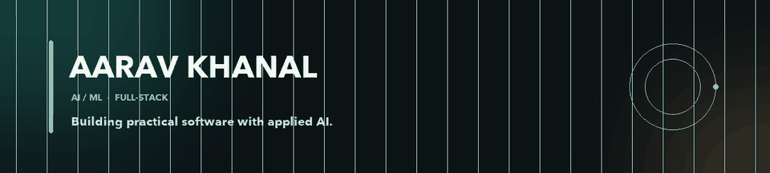

# Aarav Khanal

**AI/ML and full-stack developer building practical software with applied AI.**

I like taking an idea from the first experiment through to a tool people can use. My work spans applied AI, language-model research, and developer tools.

## AI/ML projects

| Project | What it does |
| --- | --- |
| [UnderstandVideo AI](https://github.com/Aaravkhanal/understandvideo-ai) · [Live app](https://understandvideo-ai.onrender.com) | Search and explore videos through transcripts, scene navigation, and timestamp-linked answers. |
| [ProjectMind AI](https://github.com/Aaravkhanal/ProjectMind-AI) | Multi-agent code review with project context and model choice. |
| [FrameFlow AI](https://github.com/Aaravkhanal/Frameflow-ai) | Turns screenshots, Figma designs, and website references into frontend starting points. |
| [Nexora AI](https://github.com/Aaravkhanal/NEXORA-AI) | Company research gathered into an interactive dashboard with follow-up questions. |
| [MY-LLM](https://github.com/Aaravkhanal/MY-LLM) | A decoder-only language model trained from scratch, with a tokenizer, training and evaluation pipeline, fine-tuning, terminal chat, and API. |
| [NeuralForge AI](https://github.com/Aaravkhanal/NEURALFORGEAI) | Multi-agent AutoML and explainability workflows, from dataset cleaning through model export. |
| [Jubidate AI](https://github.com/Aaravkhanal/Jubidate_ai) | AI agents debate a question from different positions and return a reasoned summary. |

## Research projects

| Project | Question and current status |
| --- | --- |
| [Canary Study: Memorization vs. Compositional Creativity](https://github.com/Aaravkhanal/canary-memorization-study) | A controlled study of how repeated story elements affect language-model exposure and recall. The computational experiments and exposure analysis are complete; blinded human novelty ratings remain unfinished, so the project does not claim a memorization–creativity trade-off. |

## Terminal-based projects

| Project | What it does |
| --- | --- |
| [CODEXA](https://github.com/Aaravkhanal/CODEXA) | An installable, terminal-native AI coding agent with multi-agent workflows and local or hosted model providers. |
| [GITOWN](https://github.com/Aaravkhanal/GITOWN) | A development-alpha code hosting platform with native Git workflows and a compatible command-line client. |

## Other work

[VIBE-SHIELD](https://github.com/Aaravkhanal/VIBE-SHIELD) · [VIBE-AI](https://github.com/Aaravkhanal/VIBE-AI) · [Zaika AI](https://github.com/Aaravkhanal/Zaika-ai)

## Tools I use

Python · TypeScript · JavaScript · React · Next.js · FastAPI · PostgreSQL · Supabase · PyTorch · OpenCV · Docker

Based in Bengaluru, India; studying at BMS College of Engineering. Open to internships, research collaborations, and thoughtful product work.

## Get in touch

[LinkedIn](https://www.linkedin.com/in/aarav-khanal-40795832a/) · [Email](mailto:khanalaarav2063@gmail.com) · [All repositories](https://github.com/Aaravkhanal?tab=repositories)

## Contribution trail

<picture>
  <source media="(prefers-color-scheme: dark)" srcset="https://raw.githubusercontent.com/Aaravkhanal/Aaravkhanal/output/github-contribution-grid-snake-dark.svg">
  <source media="(prefers-color-scheme: light)" srcset="https://raw.githubusercontent.com/Aaravkhanal/Aaravkhanal/output/github-contribution-grid-snake.svg">
  
</picture>
